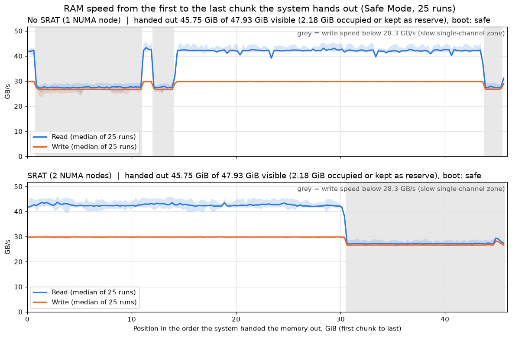

# FastRAM First

Makes Windows use dual-channel memory first on asymmetric RAM setups (for example 3 × 16 GB). An ACPI SRAT table describes the fast and slow zones as two NUMA nodes, and [OpenCore](https://github.com/acidanthera/OpenCorePkg) injects it at boot. Windows files and the firmware are not changed.

## The problem

In some cases a system has an asymmetric memory setup, such as 3 × 16 GB. The memory controller then divides the address space into two zones:

- **Dual-channel:** the capacity present in both channels. Data is interleaved between the channels.
- **Single-channel:** the remainder in the channel that has more memory. Theoretical bandwidth here is half as high.

Windows knows nothing about these zones and hands out pages from both of them mixed together. A program can get slow memory even while plenty of fast memory is free.

## What NUMA is

NUMA (Non-Uniform Memory Access) describes a computer in which each processor reaches some memory faster than other memory. It is typical of systems with several processor sockets, but a single processor can have it too. Examples are Intel Xeon with [Sub-NUMA Clustering](https://www.intel.com/content/www/us/en/developer/articles/technical/xeon-processor-scalable-family-technical-overview.html), which splits a socket into two domains with one memory controller each, AMD EPYC with its [nodes-per-socket setting](https://infohub.delltechnologies.com/p/numa-configuration-settings-on-amd-epyc-2nd-generation/), and AMD Threadripper WX, where [only some dies have local memory access](https://ir.amd.com/news-events/press-releases/detail/855/amd-expands-2nd-generation-ryzen-threadripper-desktop-processor-line-up-powering-ultimate-computing-experiences-available-today-from-649). A processor reaches memory in [its own node faster than memory in a remote one](https://docs.kernel.org/mm/numa.html), because remote access goes through an interconnect.

Processors and memory are grouped into nodes, and an ACPI table called SRAT describes which ones belong together. The operating system uses this to keep programs close to their memory: according to [Microsoft](https://learn.microsoft.com/en-us/windows/win32/procthread/numa-support), Windows tries to run threads in the same node as the memory they use and to satisfy a memory request from within the node, allocating from other nodes if necessary.

The firmware of the test machine reports no NUMA nodes. Its asymmetric memory setup still makes some memory slower than the rest, because one zone uses two memory channels and the other uses one. This project uses NUMA nodes only to control allocation order: if the fast memory and all the cores form one node, and the slow memory forms another, fast memory goes out first. The charts below show this on the test machine.

## Why this takes a workaround

Linux has a documented kernel boot parameter for emulating NUMA nodes: [`numa=fake`](https://docs.kernel.org/admin-guide/kernel-parameters.html), which [requires `CONFIG_NUMA_EMU`](https://docs.kernel.org/next/mm/numa_emulation.html). This project did not test it.

Windows has no equivalent for this purpose, as far as the documentation shows. Its closest option is [`bcdedit /set groupsize`](https://learn.microsoft.com/en-us/windows-hardware/drivers/devtest/boot-parameters-to-test-drivers-for-multiple-processor-group-support), which is meant for testing and not for shipping systems. It creates a node for each processor group, based on processor counts, and the documentation gives no way to choose which physical memory goes into a node.

The firmware of the test machine has no SRAT table. So the node layout comes from a custom SRAT table, injected by a boot loader before Windows starts. On the test machine, Windows then reports two nodes.

## The result

The top chart shows the order in which Windows hands out memory without the table, and the bottom chart shows it with the table. Grey marks the slow zone. Fast memory now goes out first and slow memory last, while the speed of each zone stays the same.

## Why bother if slow memory stays slow

The table changes the order in which Windows hands out memory to programs, not the speed of the memory. Fast memory comes first, so it gets used more often, and slow memory is reached only when the fast zone runs out.

This can help programs that are sensitive to memory bandwidth, such as LLM inference with partial GPU offload, as long as their data fits in the fast zone. Without the table, a program can land in slow memory even when it needs far less than the fast capacity.

### Measured example: LLM inference

On the test machine, generation became 0.4–2.9% faster with the table, and prompt processing did not change. The gain was largest in the setups with the most model data in system RAM.

| Backend | Setup | Generation, tok/s: without → with table | Change | Prompt, tok/s: without → with table |
|---|---|---|---|---|
| ROCm | `-ngl 99 --n-cpu-moe 42 --ctx-checkpoints 0` | 20.89 → 21.49 | +2.9% | 175.1 → 174.9 |
| ROCm | `--fit on --ctx-checkpoints 0` | 21.77 → 21.91 | +0.6% | 190.3 → 189.8 |
| ROCm | `--fit on -fa auto` | 21.83 → 21.92 | +0.4% | 187.5 → 188.2 |
| Vulkan | `-ngl 99 --n-cpu-moe 43 --ctx-checkpoints 0` | 22.32 → 22.96 | +2.9% | 58.0 → 58.2 |
| Vulkan | `--fit on --ctx-checkpoints 0` | 23.08 → 23.30 | +1.0% | 59.8 → 60.0 |
| Vulkan | `--fit on -fa auto` | 23.10 → 23.36 | +1.1% | 59.5 → 59.5 |

- **Engine:** `llama-server` from llama.cpp, build b11840, on an AMD Radeon RX 6600 XT with 8 GB of VRAM.
- **Model:** [`flint-UD-Q4_K_XL.gguf`](https://huggingface.co/unsloth/flint-GGUF/blob/main/flint-UD-Q4_K_XL.gguf) (25 GB). The process used about 23–24 GiB of system RAM, which fits in the fast zone.
- **Common flags:** `-c 16384 -np 1 -fa on`, plus `-dev ROCm0` or `-dev Vulkan0`.
- **Method:** 10 rounds of a 1,024-token prompt and 512 generated tokens, filling the context up to about 14k. The numbers are averages of rounds 2–10, because round 1 includes warm-up.
- **Limits:** each setup ran once, and the runs with and without the table were separate sessions, so a 1–3% difference may include variation between sessions. Generation was faster with the table in 8 or 9 of the 9 rounds in every setup. Other applications and models may behave differently.

## How to use it

1. Measure the memory in Safe Mode with `membench_phys.py`.
2. Build the table with `make_srat.py`.
3. Inject `SRAT.aml` at boot with OpenCore and verify the result.

**Before you start, read the full guide: [docs/GUIDE.md](docs/GUIDE.md)**

## Disclaimer

Use this project at your own risk. You alone are responsible for any damage that results from using it, including but not limited to data loss, system instability, failure to boot and hardware damage. The software is provided "as is", without warranty of any kind (see [LICENSE](LICENSE)). Read the guide in full and back up your data before you start.

## Tested on

Everything was run and checked on this one machine only. Results on other hardware may differ.

| Component | Details |
|---|---|
| CPU | AMD Ryzen 5 5600X |
| Motherboard | ASRock B550 Steel Legend, BIOS P4.00 |
| RAM | 48 GB (3 × 16 GB) at 3733 MT/s: G.Skill F4-3600C16-16GVKC in channel A, Crucial Ballistix BL16G36C16U4B.M8FB1 in channels A and B |
| OS | Windows 10 Pro N, 64-bit (build 19045) |

## Files

| File | Purpose |
|---|---|
| `scripts/membench_phys.py` | Measures memory speed along physical addresses and allocation order ([docs](docs/membench_phys.md)) |
| `scripts/membench_phys_order_plot.py` | Charts the allocation order results |
| `scripts/make_srat.py` | Builds `SRAT.aml` from the measurements |
| `scripts/srat_dump.py` | Read-only check: which ACPI tables the firmware exposes, and the contents of SRAT and SLIT |
| `scripts/numa_check.py` | Shows which NUMA node Windows takes memory from first |

## Requirements

Windows 10 or 11 (64-bit, UEFI), Python 3, `pip install numpy matplotlib`, and a [release of OpenCore](https://github.com/acidanthera/OpenCorePkg/releases).
